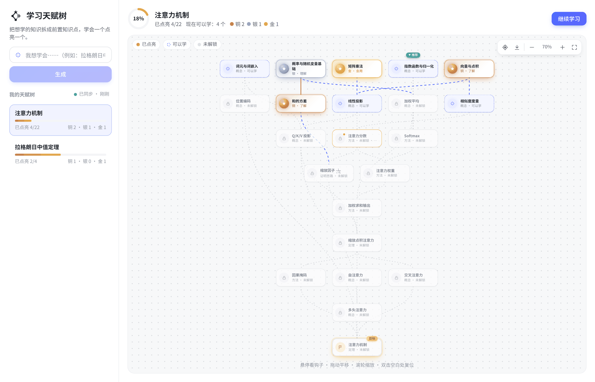
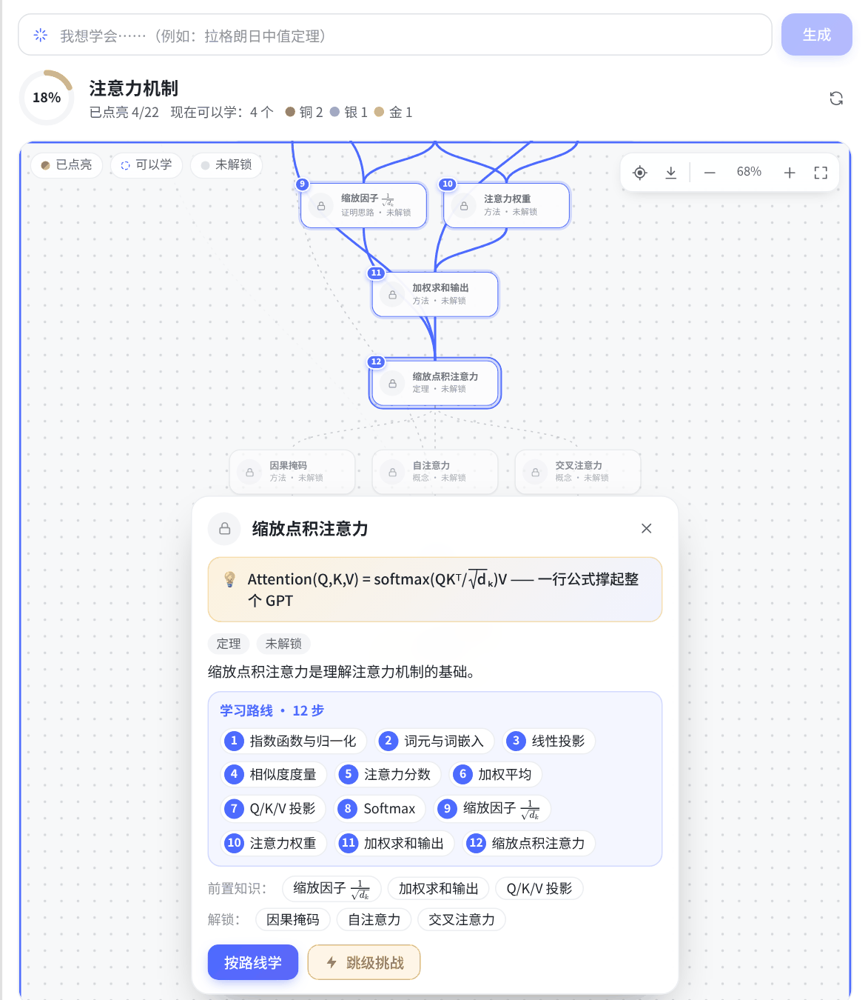
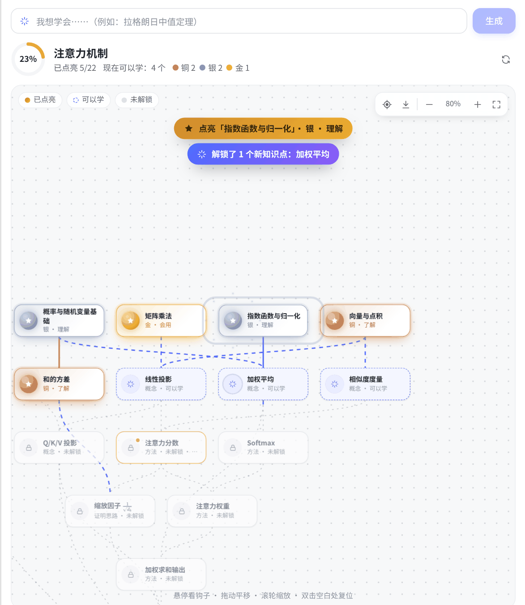
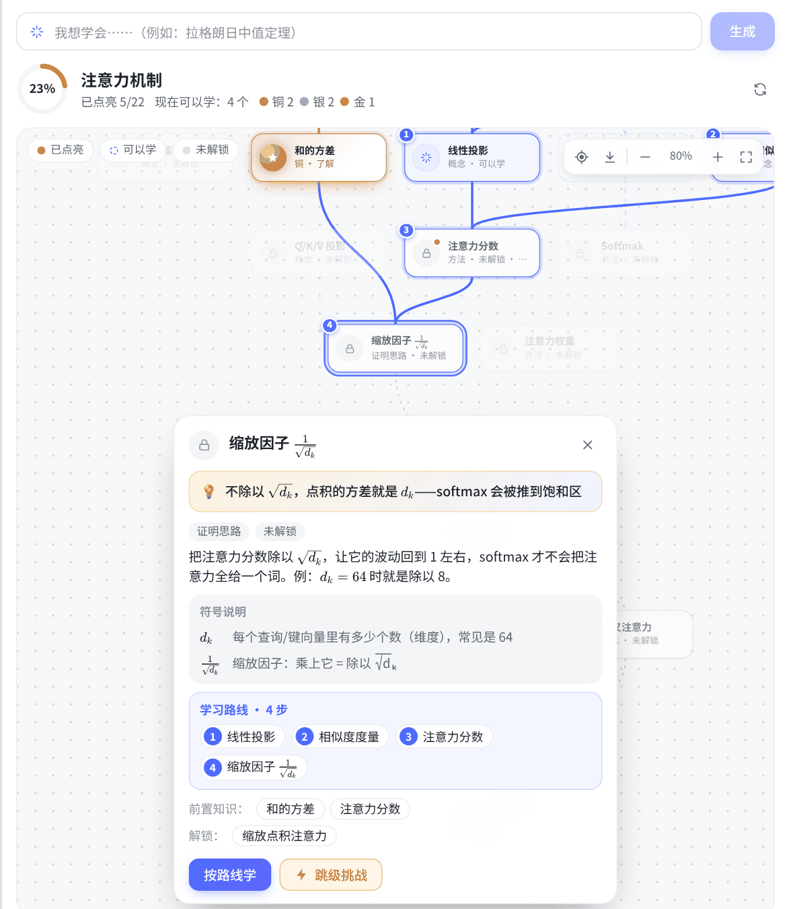

# dsh-talent-tree · 学习天赋树

[](https://www.npmjs.com/package/dsh-talent-tree) 

DeepSeek Harness 插件：说一句"我想学会拉格朗日中值定理"，AI 把它拆成一张前置知识图，像游戏里的天赋树一样显示出来。你通过讲解或小测证明自己会了，对应节点才会点亮（铜 / 银 / 金）。

> **English** — A DeepSeek Harness plugin that turns any learning goal into a game-like talent tree of prerequisite knowledge points. Each point lights up (bronze / silver / gold) only after you prove you understand it; every point comes with a "hook" (the most intriguing formula, idea or question about it), a plain-language summary and a symbol glossary. Includes a left-sidebar overview, a pannable / zoomable tree with learning routes, recommendations, light-up animations, skip-ahead challenges and PNG export.



| 学习路线和钩子 | 点亮动画 | 公式与符号说明 |
|---|---|---|
|  |  |  |

## 安装

需要 DeepSeek Harness 0.2.1 及以上、0.3.0 以下（桌面版、网页版都可以）。在 DSH 里新开一个对话，发送下面任意一种：

- **从 npm 安装（推荐）**
  > 用 plugin_manager 的 install_bundle 安装 dsh-talent-tree
- **从 GitHub 安装**
  > 用 plugin_manager 的 install_bundle 安装 github:a961282799-crypto/dsh-talent-tree
- **从本地文件夹安装**（自己改代码时用，路径必须是从盘符开始的完整路径）
  > 用 plugin_manager 的 install_bundle 安装 C:\路径\到\dsh-talent-tree

安装时 DSH 会自动重启后台。左侧栏出现「天赋树」、右侧边栏引导页出现「学习天赋树」就是装好了；没出现的话，完全退出桌面版再打开。

命令行用户也可以：`dsh plugin --profile <profile> add dsh-talent-tree`。

**从旧名升级**（`dsh-plugin-techtree` / `dsh-skilltree`）：先让 AI 用 plugin_manager 的 remove_bundle 卸掉旧包，再安装 `dsh-talent-tree`。学习进度存在 `~/.dsh/techtree/knowledge.json`，路径没变，不会丢；工具名（`techtree_plan` 等）也没变，旧对话里的树照常显示。

本插件没有第三方依赖，不会被桌面版的「依赖安装脚本」限制拦下。

## 怎么用

**左侧栏「天赋树」**（和「插件」「自动化任务」在一起）：打开后左边是你所有的学习目标，右边是选中目标的完整天赋树。数据直接从后台的 `knowledge.json` 读取（每 15 秒和切回窗口时自动刷新，左上角显示同步状态），连不上后台时显示上次同步的结果。在顶部输入框写"拉格朗日中值定理"点「生成」，会新建一个对话并填好提示词，按发送即可。点节点上的「开始学习」「检验我」或右上角「继续学习」，同样会新建一个对话接着学。

**对话里的右侧边栏**：在对话中，输入框下方会出现进度小徽章，点一下打开当前对话的天赋树；也可以在右侧边栏引导页点「学习天赋树」。这里的按钮直接把提示词发进当前对话。

**每个知识点的「钩子」**：AI 生成天赋树时，会给每个知识点配一句最能勾起兴趣的公式、想法或问题，比如「平均速度 60km/h，一定有某一刻速度表正好指着 60」。鼠标悬停在节点上就会冒出来，详情卡片顶部也会显示，开始学一个点时 AI 会先抛出它。旧的天赋树没有钩子的话，AI 下次查看时会自动补上。

**说明写得能看懂**：每个知识点的说明只用你在这一层已经学过的东西，用白话或小例子讲它是什么；提到后面的用途时也用白话，不搬后面才出现的符号。说明、名称、钩子里出现的每个符号，详情卡片的「符号说明」里都有一句白话解释（悬停气泡里也会带上），比如「$d_k$：每个向量里有多少个数（维度），常见是 64」。旧数据里看不懂的说明，AI 下次查看时会按这个标准重写。

**公式排版**：知识点名称、说明和钩子里的公式由 AI 写成 LaTeX（放在 `$…$` 里），用和聊天区同一套 KaTeX 排版，分式、根号、上下标都正常显示；拿不到 KaTeX 时插件自带一个简易排版器兜底。旧数据里直接写的 `1/√d_k`、`x^2` 也会自动美化，AI 下次查看时会把它们改写成 LaTeX。导出图片时公式转成 Unicode（如 1/√dₖ）。

**学习路线与推荐**：

- 绿色「推荐」标签标出现在最该学的那个点；打开天赋树时如果整棵树太小看不清，镜头会自动对准它。右上角 ◎ 按钮随时跳回推荐点。
- 点一个还没解锁的节点，路线上要学的点会标上 ①②③，详情卡片里列出完整路线。「按路线学」让 AI 按这个顺序带你学；「跳级挑战」让 AI 出综合题，答对就直接点亮它和你已经会的前置。
- 点详情卡片里的前置、解锁或路线，镜头会平滑飞过去。

**点亮的时候**：节点弹一下、炸出一圈光点，连出去的线依次亮起，顶部提示「点亮 X」「解锁了 N 个新知识点」，镜头自动移过去。

**导出图片**：右上角 ⤓ 按钮把整棵树（含钩子）存成 PNG，同时复制到剪贴板。

**操作天赋树**：

- 按住拖动（空白处或节点上都行）平移，拖动时不会选中文字；滚轮缩放，触控板双指滑动平移、捏合缩放。
- 右上角「－ / ＋ / 适应窗口」按钮；双击空白处复位；画布获得焦点后也能用方向键、`+` `-` `0`。

### 节点状态

| 外观 | 含义 |
|---|---|
| 锁形图标，半透明 | 前置知识还没点亮 |
| 蓝色虚线框，图标轻微呼吸；连到它的线在流动 | 前置全部点亮，现在就能学 |
| 铜 / 银 / 金色奖章发光（金色带扫光） | 了解 / 理解（能说出为什么）/ 会用（能解新题） |
| 橙色边框 + 橙色小圆点 | 答题暴露了漏洞，需要加固 |
| 发光变暗 + "该复习了" | 太久没复习（铜 3 天、银 7 天、金 21 天） |

### 跨对话的个人知识地图

所有节点和掌握程度存在 `~/.dsh/techtree/knowledge.json`（设置了 `DSH_HOME` 时在 `$DSH_HOME/techtree/`）。新开一个对话学泰勒公式，"导数的定义"这类已经学过的节点会自动复用并保持点亮。想在新对话里接着看旧的天赋树，跟 AI 说"打开我的拉格朗日中值定理天赋树"即可（它会调用 `techtree_view` 并传 `goal_id`）。

换存储位置：在 profile 的 `cordis.patch.yml` 里覆盖这一行（桌面版的文件在 `~/.dsh/profiles/desktop/cordis.patch.yml`，设置了 `DSH_HOME` 时在 `$DSH_HOME/profiles/desktop/`）：

```yaml
- insert:
    - id: techtree
      name: dsh-talent-tree
      config:
        dataFile: /绝对路径/knowledge.json
```

## 结构

| 文件 | 作用 |
|---|---|
| `index.js` | Host 端：三个工具、教学规则提示词、`techtree` 会话投影、知识地图读写、左侧栏用的 `GET /api/techtree/library`（走桌面版登录校验） |
| `graph.js` | 纯逻辑：校验、按 id/名称去重合并、环检测、前置闭包、节点状态 |
| `client.js` | 界面：左侧栏「天赋树」入口和主面板、右侧边栏页面、可拖动缩放的节点图（路线、推荐、钩子气泡、点亮动画、导出 PNG）、composer 下方的进度徽章 |
| `test/` | `npm test`（Node 22+），覆盖图逻辑、工具→投影数据流、界面渲染 |
| `docs/` | README 用的截图（不随 npm 包发布） |

### 模型能用的工具

- `techtree_plan(goal_id, nodes[])`：生成或扩展天赋树，每个节点带 `hook`（钩子）。依赖不存在或成环时会报错让模型重来。
- `techtree_record(node_id, level 0-3, weak?, evidence)`：记录掌握程度，必须写明证据。
- `techtree_view(goal_id?)`：读取当前进度，带上 `goal_id` 可以把旧目标拉进当前对话。

### 数据流

每次工具调用都把当前对话的完整天赋树快照写进工具结果的 `meta`，`techtree` 会话投影折叠这些结果并推给前端。所以侧边栏和对话记录永远一致，恢复、分叉对话也不会错乱。全局 `knowledge.json` 只负责跨对话共享掌握程度。

### 对模型上下文的影响

- 系统提示词增加一段固定的教学规则（约 750 token），内容不变，不影响 KV 缓存复用。
- 三个工具的 schema。
- 天赋树内容只出现在工具结果里，不进系统提示词。

## 已知限制

- 侧边栏不会在生成天赋树后自动弹出，需要点进度徽章或从引导页打开。
- 从左侧栏发起的学习会新建对话并填好提示词，需要自己按发送。
- 在另一个对话里点亮的节点，要等当前对话下一次调用 techtree 工具（或点「刷新」）才会更新。
- 界面文字只有中文和英文；其他语言显示英文。
